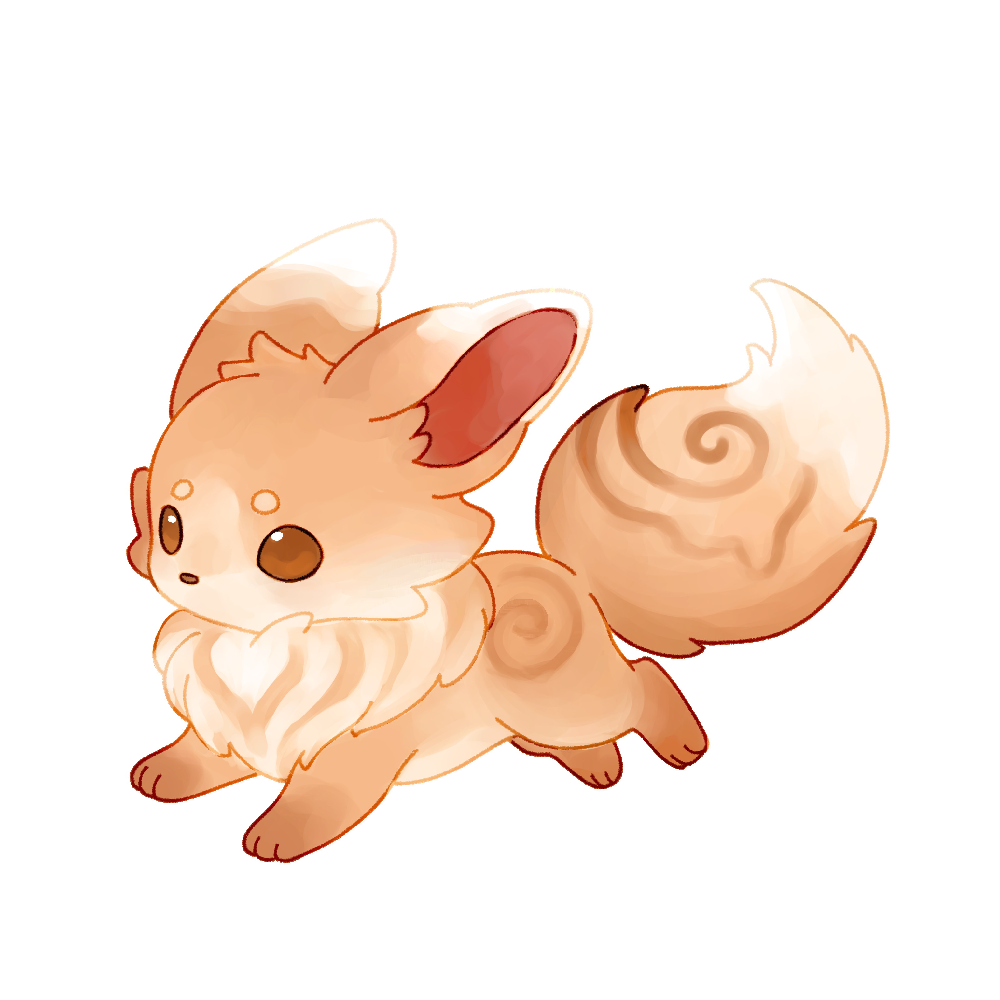

# 全面重做計畫：《肉桂捲的小鎮》（暫名）

> **狀態：草案，等你確認。** 確認前不會刪除或改動現在的遊戲。
> 確認後：
> - 舊的 `game/` 凍結；
> - 新遊戲在新的資料夾從零開始；
> - `CLAUDE.md` 改寫成新的規則。
>
> 你的要求：
> - 整個遊戲徹底重構，不保留角色與存檔；
> - 參考 inZOI、The Sims 4、Tomodachi Life: Living the Dream、Animal Crossing: New Horizons、角色觀察屋；
> - 風格與美學盡量參考 Nintendo 遊戲；
> - 預設角色只有「肉桂捲」（種族未知）；
> - 地圖先限於小鎮與住宅，以後再擴展；
> - 類型：**像角色觀察屋一樣的生活模擬＋桌寵**。



---

## 目錄

0. 一句話與設計支柱
1. 參考作品：吸收什麼、不拿什麼
2. 肉桂捲
3. 玩家是誰、怎麼玩（核心循環）
4. 世界：住宅與小鎮
5. 美術與美學（Nintendo 式的原則）
6. 生活模擬
7. 觀察
8. 互動
9. 時間、背景生活與回憶
10. 物品、佈置、穿搭、小鎮經濟
11. 桌寵
12. 介面與操作
13. 聲音與觸覺
14. 技術架構
15. Android
16. 品質、效能、測試
17. 里程碑
18. 這次不做（以後再說）
19. 風險
20. **需要你決定的事**（每一項都附我的建議）

---

## 0. 一句話與設計支柱

**一句話**：一隻叫肉桂捲的小動物住在小鎮的家裡，牠自己過日子；你隨時打開來看看牠在做什麼，偶爾幫牠一把；你不在的時候牠也照樣生活，桌面上還有一隻小小的牠陪著你。

**五個支柱**（每個功能都要對得上至少一個，對不上的不做）：

| 支柱 | 意思 | 例子 |
|---|---|---|
| **① 牠是活的** | 每個動作都有原因，而且看得出來 | 頭上冒出「好睏…」，然後走去床邊；被摸到喜歡的地方會瞇眼 |
| **② 看就好玩** | 什麼都不做也有戲看 | 牠會自言自語、做夢、對窗外的鳥發呆、把餅乾藏起來 |
| **③ 每天回來看看** | 現實時間；離開時生活照常；回來有故事 | 「你不在的 9 小時：牠午睡了兩次、在麵包店門口站了很久…」 |
| **④ 摸得到的手感** | 每一下觸碰都有動畫、聲音、震動回饋 | 按鈕會壓下去再彈回來；摸牠的耳朵，耳朵真的會動 |
| **⑤ 小而精** | 一個家、一條街，做到很細，不求大 | 先做好 1 間房子、5 個鎮上的地點，比 20 個做一半的地點好 |

**和舊版最大的不同**：
- **舊版**：系統很多（17 個大版本、幾十個子系統），但每個都只做到一部分，玩家感受不到因果。
- **新版**：系統少一半以上，每一個都做到：
  - 看得見；
  - 有手感；
  - 有測試。

---

## 1. 參考作品：吸收什麼、不拿什麼

**共同規則（和以前一樣，而且更嚴格）**：
- 只吸收**設計原則**；
- 不使用任何作品的角色、名稱、文字、台詞、介面圖形、圖示、字體、地圖、戶型、模型、音樂、音效；
- 也不做「換個名字的某款遊戲」：
  - 畫面看起來不能讓人誤以為是某款任天堂遊戲；
  - 介面不能是某款遊戲手機 App 的翻版；
  - 角色不能是某個既有角色的改名。

| 作品 | 吸收的原則 | 刻意不做的 |
|---|---|---|
| **角色觀察屋** | 以觀察為主；現實時間；離開時照樣生活、回來看「你不在的時候」；每件事一條的時間線；收藏與回放；每天結算的關係；戶型圖點人跟拍；細緻的個性／作息／喜好／自訂事件設定 | 它的文字、戶型圖、介面配色與版面 |
| **The Sims 4** | 需求與情緒「有原因、有時間」；情境選單列出現在能做的事與「為什麼不行」；建造／佈置和生活分開；物件驅動行為（東西告訴角色能拿它做什麼） | 複雜的建造工具（我們只做擺放）；職業與技能樹的龐大體系 |
| **inZOI** | 角色的「想法」攤開給你看（現在想什麼、為什麼）；生活的密度（隨時都有小事發生）；強的外觀與物件自訂 | 寫實美術；大城市 |
| **Tomodachi Life: Living the Dream** | 觀察的樂趣：住民自己過日子、會帶著具體的小煩惱來找你；荒謬又溫柔的小劇場（夢、奇怪的念頭）；關係變化是大事件 | 它的角色製作方式、任何劇情與台詞。**註**：這款我沒有實際遊玩資料，只用系列已知的原則 |
| **Animal Crossing: New Horizons** | 現實時鐘與每日的小變化；季節與節日改變整個環境；介面極少、世界優先；每次互動都有聲音＋動畫＋文字回饋；收集與佈置的滿足感；台詞量大、很少重複 | 島嶼開發；它的角色類型、說話方式、手機介面、圖示、字體 |
| **Nintendo 整體美學** | 見第 5 節（圓潤、玩具感、高可讀性、手感、溫度） | 任何任天堂的角色、商標、素材、字體與介面外觀 |

---

## 2. 肉桂捲

### 2.1 外觀（依你的圖）

- **毛色**：奶油色到淺焦糖色；尾巴與身體側邊有**肉桂捲一樣的漩渦紋**；尾巴尖端是白色。
- **頭部**：
  - 兩隻大耳朵，內側是紅棕色；
  - 頭頂一撮翹毛；
  - 額頭兩個淺色圓點；
  - 大大的棕色眼睛、小小的鼻子。
- **胸前**有一圈白色的蓬鬆毛（像心形的領子）。
- **體型**：四足、圓滾滾、腳短。
- **種族**：**未知**。在遊戲裡就寫「種族：未知」。

### 2.2 「種族未知」變成玩法

牠是什麼？沒有人知道，包括牠自己。小鎮上偶爾會有線索：
- 圖書館的舊書裡有一張很像牠的插圖；
- 牠在下雨天會做奇怪的夢；
- 某些食物牠特別有反應。

收集到的線索放進「牠的筆記本」。

**這是長期的小謎題，永遠不會給出唯一答案**（避免把你的角色設定寫死）。如果你以後想寫牠的身世，可以自己填進筆記本。

### 2.3 預設個性（**建議**，你可以改）

| 項目 | 建議 |
|---|---|
| 個性 | 好奇、黏人、有點膽小、貪吃（甜食）、愛乾淨 |
| 喜歡的事 | 曬太陽、聞麵包香、被摸耳朵後面、收集圓圓的東西、看雲 |
| 不喜歡的事 | 打雷、被抓尾巴、苦的東西、太吵 |
| 作息 | 早上 8 點起床（會賴床 10 分鐘）、下午小睡、晚上 11 點睡 |
| 說話 | 不說人話；用**聲音＋表情泡泡＋小字**表達，例如「（聞聞）」「♪」「…？」 |

**關於「說話」的建議**：
- 牠是種族未知的小動物，不說人話，比說人話更有魅力；
- 寫台詞的成本也低很多，品質更容易做好；
- 「說話方式」可以在設定裡改成會說話（給以後的角色用）。

### 2.4 一張圖怎麼動起來

你的圖只有一張，而且背景已經是透明的。新版的做法：

1. **分區**：工具自動找出耳朵、頭、身體、尾巴、四肢，再讓你用手指修正（約一分鐘）。這些區域只是標記，**不會改你的原圖**。
2. **網格變形動畫**：圖貼在一張可以彎曲的網格上，各區域各自動：
   - 耳朵擺動、尾巴搖、身體呼吸與擠壓伸展、頭轉向、眨眼（在眼睛上蓋一層眼皮）、腳步。
3. **「紙片角色」**：在 3D 的小鎮裡，牠像一張有厚度的紙偶：
   - 轉身時翻面（背面用同一張圖加暗一點的色調，或你另外畫一張背面）；
   - 這是任天堂常見的「紙片角色在立體世界」的手法，但我們只用這個原則，造型與材質都自己做。
4. **以後想要更好的動畫**：每個動作都可以換成你畫的逐格圖，沒畫的動作照樣用網格動畫。

**需要的動作**（第一版約 30 個）：
- 站、走、跑、坐、趴、睡、伸懶腰、打哈欠、吃、喝；
- 聞、抓癢、搖尾巴、跳、跌倒、躲起來、探頭、開心轉圈、生氣、害怕發抖、哭、撒嬌、被摸、被抱起、掙扎、玩球、看書（假裝）、洗澡、發呆、做夢。

### 2.5 以後的其他角色

- **預設只有肉桂捲一隻**；新遊戲不會自動加入任何人。
- 你可以自己新增角色（匯入一張圖，走同樣的分區流程），**最多 8 位**。
- 小鎮上的店員也不是新角色：
  - 店是「沒有人的店」（自助、招牌、告示）；
  - 或是由你以後新增的角色去上班。
- 只有一隻時，生活模擬也要好玩：
  - 牠和**東西**、**天氣**、**小鎮**、**你**互動；
  - 牠也和**小動物**（鳥、蝴蝶、魚、貓頭鷹）互動，這些不是角色，只是環境裡的生物；
  - 社交需求由「你」和「小鎮」滿足。

---

## 3. 玩家是誰、怎麼玩

### 3.1 玩家的身分（建議）

- **你是看不見的「照顧者」**：不出現在畫面上，透過一支小小的「口袋手機」和觸控照顧牠。
- 理由：
  - 觀察遊戲的主角是牠，不是你；
  - 不用做玩家角色的外觀、走路、碰撞，省下的力氣放在牠身上。

### 3.2 一次遊玩（2–10 分鐘）

1. **打開** → 「你不在的時候」（如果離開超過一小時）：離開多久、一兩件小事、一張照片般的畫面。
2. **看看牠**：
   - 牠正在做自己的事；
   - 頭上有想法泡泡；
   - 點牠＝看人物卡（現在在做什麼、為什麼、心情、需求）。
3. **偶爾介入**（不強迫）：
   - 摸摸、餵點心、給牠一個東西；
   - **建議**牠做某件事（牠可能接受，也可能說「…等一下」）；
   - 佈置家裡、幫牠換衣服。
4. **小鎮**：
   - 跟著牠去散步，或叫牠出門；
   - 買東西、看今天鎮上有什麼不一樣（季節、節日、新到的東西）。
5. **關掉** → 桌面上的小肉桂捲繼續陪你。

### 3.3 長期（幾週到幾個月）

- **回憶**：時間線、收藏、相簿、「名場面」、牠的筆記本（身世線索）。
- **家**：慢慢收集家具與小東西，把家變成你和牠喜歡的樣子。
- **牠的成長**：
  - **習慣**：你常做的事會變成牠的習慣（要你同意才固定下來）；
  - **喜好**：喜好會慢慢被發現（不是一開始就全部攤開）；
  - **小技能**：牠學會的小把戲，例如自己開燈、把球叼回來。
- **季節與節日**：一年四季的小鎮變化（原創的節日）。
- **以後**：其他角色住進來 → 關係、每天結算、紀念日（舊版 17.3 的設計會重新做）。

---

## 4. 世界：住宅與小鎮

**原則**：小而精，每個地方都有可以做的事、會變化的東西、牠會有反應的東西。

### 4.1 住宅：「肉桂捲的家」

一棟小小的兩層屋（有樓梯，所以戶型圖有**樓層切換**）：

| 樓層 | 房間 | 可以做的事 |
|---|---|---|
| 一樓 | 客廳 | 沙發（坐、躺、窩）、地毯、窗邊（曬太陽、看鳥）、收音機（聽音樂） |
| 一樓 | 廚房兼餐桌 | 冰箱（找吃的）、餐桌（吃）、烤箱（你可以和牠一起烤點心） |
| 一樓 | 玄關 | 出門、信箱（每天會有東西） |
| 二樓 | 臥室 | 床（睡、賴床）、衣櫃（換衣服）、梳妝鏡 |
| 二樓 | 浴室 | 澡盆（洗澡）、毛巾（甩乾） |
| 二樓 | 小閣樓（第二階段開放） | 收藏品架、望遠鏡（晚上看星星） |

- 室內可以佈置：擺放、旋轉、收回、換牆壁地板；用網格擺放，不做自由建造。
- 每件家具都「告訴」牠能拿它做什麼（The Sims 的原則）；新家具＝新行為。

### 4.2 小鎮：「雲朵鎮」（暫名）

一條主街＋一個廣場，鏡頭可以從家門口一路走到另一端：

| 地點 | 是什麼 | 牠會做的事 | 你可以做的事 |
|---|---|---|---|
| 廣場 | 噴水池、長椅、告示板、季節裝飾 | 追鴿子、坐著發呆、看噴水池 | 看告示板（今天的消息、節日） |
| 麵包店 | 自助式的小店（招牌、玻璃櫃） | 聞香味聞到入迷 | 買點心 |
| 雜貨店 | 日用品、種子、小東西 | 東看西看 | 買東西 |
| 家具店 | 每天換幾樣 | 坐坐看沙發 | 買家具 |
| 小公園 | 花圃、樹、池塘 | 玩、聞花、看魚 | 一起散步 |
| 圖書館（第二階段） | 書架、閱讀角 | 假裝看書、在書上睡著 | 找身世線索 |

**以後擴展的方式**：
- 地圖是一個一個「區塊」，新地點加在街的兩端；
- 舊的地點不用改；
- 地圖上**不放鎖住的假入口**，還沒做的就不出現。

### 4.3 環境生物

鴿子、麻雀、蝴蝶、池塘的魚、晚上的螢火蟲：
- 都是純環境；
- 牠會注意到、追、看；
- 不是角色，沒有需求。

---

## 5. 美術與美學（Nintendo 式的原則）

### 5.1 我們要學的原則

1. **玩具感**：
   - 所有東西像是用軟陶、木頭、布做的小模型；
   - 圓角、厚實、比例可愛（頭大、腳短、門窗大）。
2. **高可讀性**：
   - 一眼看懂什麼能點、牠在做什麼；
   - 剪影清楚；
   - 重要的東西有輪廓光。
3. **溫度**：
   - 暖色主光、柔和的陰影；
   - 早晨偏金、黃昏偏粉、夜晚偏藍紫，但永遠不髒、不暗沉。
4. **手感**（最重要）：
   - 每個按鈕、每次觸碰都有「壓下去 → 彈回來」的動畫與聲音；
   - 東西出現時會「蹦」出來，不是淡入；
   - 動態用彈簧曲線。
5. **簡潔的畫面**：
   - 世界永遠是主角；
   - 介面平常幾乎看不見，需要時才浮出來。
6. **一致**：
   - 同一套形狀語言（圓角半徑、線條粗細、陰影方向）貫穿世界、介面、桌寵；
   - 白天和夜晚是同一套設計的兩個調色盤。

### 5.2 我們的具體做法

| 項目 | 做法 |
|---|---|
| **世界** | 3D 的「立體透視小模型」：<br>・固定斜上方視角（約 45°）、正交投影；<br>・**看得到一點點立體透視的手感**：遠景輕微模糊（只在高畫質）、地平線微微彎曲（可關）；<br>・材質是平滑的上色（toon shading）＋柔和的環境光遮蔽，不用寫實貼圖 |
| **角色** | 紙片角色（見 2.4）：<br>・在立體世界裡有一點厚度的邊；<br>・地上有柔軟的圓形影子；<br>・**保留你的手繪筆觸**，不另外打光；只在夜晚整體壓暗、靠近燈時有暖光 |
| **配色** | 原創調色盤：<br>・奶油白、焦糖、薄荷、天空藍、莓果紅點綴；<br>・**和肉桂捲的顏色呼應**（暖棕色系為主調，讓牠在任何場景都好看） |
| **介面** | 圓角的「紙片＋貼紙」風格：<br>・大圓按鈕、粗而圓的字；<br>・原創圖示（一套自己畫的貼紙圖示）；<br>・**字體**：用開放授權的圓體（例如 Huninn／源泉圓體），需要時再確認授權 |
| **特效** | 少而有用：<br>・愛心、星星、汗滴、問號、音符、Z z z；<br>・全部用同一套貼紙風格 |
| **季節** | 春櫻、夏日綠、秋紅、冬雪，連小鎮的裝飾一起換 |

### 5.3 不做的

- 寫實、過度後製（光暈、景深、色差）、全螢幕濾鏡。這些在手機上慢，而且不是任天堂式的乾淨。
- 任何「看起來像某款任天堂遊戲」的介面或物件設計。

---

## 6. 生活模擬

**原則**：比舊版少，但每一個都**看得見原因**、**有手感**、**有測試**。

### 6.1 需求（5 個，舊版 9 個）

| 需求 | 下降 | 回復 | 低的時候看得到 |
|---|---|---|---|
| 飽足 | 隨時間 | 吃 | 肚子咕嚕、去冰箱前面 |
| 精神 | 醒著的時間、活動 | 睡、小睡 | 打哈欠、走路變慢 |
| 乾淨 | 玩、外出、吃東西 | 洗澡、舔毛 | 身上出現小灰塵貼紙 |
| 好玩 | 無聊 | 玩、外出、新東西 | 嘆氣、躺著翻滾 |
| 被愛 | 沒人理 | 被摸、被陪、被誇 | 跟著鏡頭、看著你 |

### 6.2 心情

- 心情**有來源、有時間**（The Sims 的原則）：
  - 例：「開心：剛吃了草莓塔（還有 40 分鐘）」「有點怕：外面在打雷」；
  - 人物卡上列出每個來源。
- 心情決定：走路的步調、待機動作、聲音、想做的事。

### 6.3 自主行為

**流程**：
1. 候選：每一件可以做的事，來源是家具、地點、天氣、時間。
2. 打分：分數＝需求 × 個性 × 喜好 × 心情 × 作息 × 最近做過的（避免重複）。
3. 選擇：從最高的幾個裡選一個（有一點隨機）。

**可解釋**：
- 每次選擇都留下理由（「肚子有點餓＋喜歡麵包＋現在是點心時間」）；
- 人物卡與想法泡泡都看得到。

**作息優先**：你設定的起床、睡覺時間最優先（角色觀察屋的原則）。

### 6.4 個性與喜好

- **個性**：最多 10 個，分五類（習慣、社交、脾氣、起居、做事）：
  - 每個都寫出實際影響（從資料自動產生）；
  - 有互斥。
- **喜歡／不喜歡的事**：各最多 10 件，改變自主行為的分數，也改變表情與聲音。
- **口味**：喜歡、不喜歡的食物，第一次吃到時才會「發現」，筆記本記下來。

### 6.5 「小劇場」：讓看就好玩

角色觀察屋與 Tomodachi Life 的原則：每天都有幾件「有戲」的小事，是一段一段的短演出：

- **小念頭**（一天幾次）：
  - 盯著窗外的雨、把襪子當成獵物、對鏡子裡的自己吠；
  - 偷偷把餅乾藏到沙發下面，之後忘記；
- **夢**：睡覺時頭上的夢泡泡（幾十種原創的夢）；
- **來找你**（一天最多一兩次，可以調整）：
  - 帶著具體的小事來，例如「想吃上次那個甜的」「衣櫃裡的帽子不見了」；
  - 你可以回應，也可以不理。
- **小鎮的偶遇**：
  - 鴿子搶走牠的麵包屑；
  - 麵包店新出爐的香味讓牠停下來；
  - 下雨天在屋簷下躲雨。

每一個都是**資料**（條件、步驟、台詞／表情），不是寫死的程式，以後可以一直加。

**目標**：第一版 60 個以上，正式版 200 個以上。

### 6.6 自訂

- **自訂作息**：起床、睡覺、小睡、吃飯時間，以及賴床、熬夜的傾向。
- **自訂日常事件**（表單，不用寫程式）：
  - 欄位：什麼事、多久一次、在哪裡、做多久、什麼時候；
  - 例：「每天傍晚在窗邊等你回家」。
- **屏蔽**：不想看到的事件或類型可以關掉。

---

## 7. 觀察

觀察是**主要玩法**，介入是點綴。

| 功能 | 內容 |
|---|---|
| **預設就是觀察** | 打開遊戲就在看牠；沒有「操控模式」 |
| **自動鏡頭** | 輕輕跟著牠；有小劇場時鏡頭會靠過去（可以關） |
| **自由鏡頭** | 拖曳移動、捏合縮放（在範圍內）；放手幾秒後慢慢回到牠身上 |
| **人物卡** | 點牠打開：<br>・現在在做什麼、為什麼；<br>・心情與來源、五個需求；<br>・今天的事、最近發現的喜好 |
| **戶型圖** | 2D 的家的俯瞰圖：<br>・**有樓層切換**；<br>・圓點標出牠在哪；<br>・點了鏡頭就過去 |
| **時間線** | 每件事一條：<br>・篩選（地點、類型）、長按收藏；<br>・「第 N 天結束了」 |
| **時間速度** | 1×（現實時間）為主；觀察時可以快轉 2×–60×（只在「遊戲時間」模式） |

---

## 8. 互動

**所有互動都是「請求」或「照顧」，不是「操控」**：牠有權說不，而且會說明原因。

| 互動 | 怎麼做 | 手感 |
|---|---|---|
| 摸 | 手指在牠身上滑動；不同部位反應不同（耳朵後面最喜歡、尾巴不喜歡） | 毛被撥動的網格變形、呼嚕聲、震動節奏 |
| 抱起／放下 | 長按拿起、拖到別處放下 | 腳懸空亂踢、放下時彈一下 |
| 給東西 | 從口袋把東西拖到牠身上 | 牠聞一聞，依喜好反應 |
| 餵 | 給食物，牠會吃（等牠吃完才算） | 嚼嚼的動畫與聲音 |
| 建議 | 點家具或地點 →「建議牠去…」 | 牠想一下（想法泡泡）→ 去，或搖頭並說明原因 |
| 一起做 | 烤點心、散步、拍照（簡單的觸控小遊戲） | 每個都是一兩分鐘的小遊戲 |
| 稱讚／安慰 | 在人物卡上 | 牠的表情與聲音 |

**防誤觸**：點東西只會出現動作卡，按了才做（舊版 15.0 學到的教訓）。

---

## 9. 時間、背景生活與回憶

舊版 17.1 的設計證明可行，這次一開始就做進核心。

- **現實時間**：遊戲時間＝手機時間（預設）；或「遊戲時間」模式（可以快轉）。
- **離開時照樣生活**：
  - 最多推算 30 天；
  - 結果只由存檔決定：同一個存檔、同一段離開，兩次結果完全一樣；
  - 時間被往回調時不推算。
- **離開時不給**星幣與物品（避免「關掉等收穫」）。
- **「你不在的時候」**：離開多久、一兩件大事、名場面、一張畫面。
- **時間線、收藏、回放**：
  - 過去的一天可以 1×–1024× 重播；
  - 「在家裡看」會在 3D 裡用泡泡＋鏡頭重演。
- **相簿**：拍照模式（相框、貼紙，不用全螢幕濾鏡）。
- **備份**：
  - 匯出成一個檔案，或「一張藏著存檔的圖片」；
  - 不做雲端（不需要伺服器，資料不離開手機）。

---

## 10. 物品、佈置、穿搭、小鎮經濟

- **星幣**：
  - 每天的小任務（例如「和牠散步一次」）、賣掉多的東西、信箱裡偶爾的小禮物；
  - 不做打工、職業。
- **物品**：
  - 種類：食物、家具、衣服與配件、玩具、收藏品；
  - 第一版約 120 件，全部原創，用統一的程序式圖示風格。
- **帳本**：每一筆收支都有紀錄（舊版的 `Tx` 原則保留：唯一的入口、不會重複發獎勵）。
- **佈置**：網格擺放、旋轉、收回、牆壁地板，可以復原。
- **穿搭**：
  - 帽子、圍巾、蝴蝶結、眼鏡、小背包；
  - 用網格變形「貼」在牠的對應部位（頭、脖子、背），跟著動；
  - 你也可以匯入自己畫的配件。
- **烤點心**：
  - 你和牠一起做（觸控小遊戲：揉麵團、捲肉桂捲、等烤好）；
  - 主題呼應牠的名字，是小鎮生活的招牌玩法。

---

## 11. 桌寵

**目標**：桌面上的小肉桂捲就是遊戲裡的牠：
- 同一隻、同一個心情、同一天的經歷；
- 牠在桌面做的事會回到遊戲，變成回憶。

| 層 | 內容 |
|---|---|
| **想做什麼**（Mind） | 依遊戲給的快照（需求、心情、作息、個性）每幾秒決定目標：休息、找你、玩、發呆、去桌面物件、睡覺 |
| **怎麼做**（Planner） | 把目標變成一串動作：走到坐墊 → 趴下 → 睡 |
| **身體**（Motion） | 走、跑、跳、坐、趴、睡、爬螢幕邊、倒吊、掉落、探頭 |
| **反應**（React） | 點、摸、抓起來丟、通知、打開 App 時的反應，可以打斷其他層 |
| **臉**（Face） | 眨眼、看向你的手指、表情，疊在任何動作上 |

**動畫**：
- 用和遊戲同一套網格變形，在遊戲裡先算成影格，交給桌面播放；
- 桌面不需要 3D。

**桌面物件**（每個都是自己的小視窗，只有物件那麼大）：
- 坐墊：牠會去睡；
- 點心碗：從遊戲放點心進去；
- 球：可以丟，牠會追；
- 小盆栽：每天澆水；
- 信箱：遊戲裡有新東西時會亮。

**模式**：
- 陪伴（預設）；
- 安靜：只坐或睡、不發聲；
- 專注：番茄鐘期間待在角落；
- 熱鬧。

**規則**：
- 只在玩家打開時才請求權限；
- 不用無障礙服務、不讀其他 App 的內容；
- 觸控穿透照 Android 規定；
- 前景服務類型只用 `specialUse`。

**誠實說明**：
- 桌寵與所有 Android 原生功能，在這個環境**只能建置與用單元測試驗證**；
- 一定要在你的手機上試過才算完成；
- 每一版都會列出要你試的清單。

---

## 12. 介面與操作

**平常畫面**（觀察時），共 4 個元件：
- 左上：時間與天氣的小膠囊；
- 右上：口袋手機的按鈕；
- 右下：相機（拍照）；
- 有通知時才出現：一個小信封。

**口袋手機**（一個原創的「小冊子」造型，不做成任何遊戲裡的手機樣子），裡面的 App：
- 牠（人物卡＋筆記本）；
- 時間線；
- 戶型圖；
- 口袋（物品）；
- 商店目錄；
- 佈置；
- 相簿；
- 桌寵；
- 設定。

**操作規則**：
- 觸控範圍 ≥ 48dp；
- 每頁最多一個主要按鈕；
- 只有不能復原的動作才跳確認；
- 返回鍵永遠有用；
- 不會出現灰色遮罩卡住的畫面（舊版 17.0 的安全網，一開始就做進來）。

**對話與文字**：
- 圓角對話泡泡、打字機效果；
- 字大、行距寬、不用波浪號堆疊。

**深色模式**：同一套設計的夜晚調色盤，跟著系統或手動切換。

**無障礙**：
- 減少動態；
- 字級放大；
- 色弱友善的狀態圖示（形狀＋顏色）；
- 震動可關。

---

## 13. 聲音與觸覺

- **全部原創、即時合成**，沒有外部音檔：
  - 牠的聲音（一組「咕嚕、啾、哼」的小聲音，隨心情改變音高與速度）；
  - 介面音；
  - 腳步；
  - 環境音（雨、風、鳥、街上的人聲氛圍）；
  - 一首會隨時間與天氣改變配器的背景音樂。
- **介面音的手感**（任天堂原則）：
  - 每個按鈕有「按下」與「彈回」兩個音；
  - 打開與關閉的音高相反；
  - 獲得東西有短短的上揚音型（原創旋律）。
- **觸覺**：分級（輕點、確認、撫摸節奏、心跳），可以完全關閉。

---

## 14. 技術架構

### 14.1 原則

1. **模擬和畫面完全分開**：
   - 生活模擬是純邏輯（沒有 DOM、沒有 3D），可以在測試裡無畫面地跑一整年；
   - 畫面只讀狀態、送出意圖。
2. **一個時鐘、一個存檔、一個事件流、一個交易入口**（舊版學到最有用的四條規則，從第一天就做）。
3. **資料驅動**：
   - 活動、物品、小劇場、台詞、個性都是資料檔；
   - 加內容不用改程式。
4. **型別與建置**：
   - 改用 **TypeScript**＋**esbuild** 打包成一個檔案（npm 套件在這個環境可以安裝）；
   - 舊版沒有建置步驟，檔案越長越難維護，這次改掉。
5. **測試先行**：每個系統都有無畫面的單元測試；畫面用 Playwright 真實觸控測試。

### 14.2 模組

```
next/                         新遊戲（舊的 game/ 凍結）
  src/core/                   時鐘、亂數（可重現）、存檔與遷移、事件匯流排、交易帳本
  src/sim/                    需求、心情、個性、作息、自主行為、小劇場引擎、背景推算、時間線
  src/world/                  地點資料、可走區域、家具與「能做的事」
  src/render/                 three.js 場景、立體透視小模型、紙片角色、網格變形、光影與季節
  src/char/                   角色分區工具、動作庫（網格變形）、表情、穿搭附著
  src/ui/                     元件庫（按鈕、卡片、泡泡、口袋手機、頁面）、動態（彈簧）
  src/audio/                  合成器、介面音、角色聲音、環境音、音樂
  src/pet/                    給桌寵的快照、影格輸出、桌面事件回收
  data/                       活動、物品、小劇場、台詞、個性、地點（JSON／TS 資料）
  tests/unit/                 模擬的單元測試（無畫面，幾秒跑完）
  tests/e2e/                  Playwright 真實觸控
android/                      保留建置管線；原生程式依第 15 節重寫
```

### 14.3 3D 與效能預算（手機為準）

| 項目 | 預算 |
|---|---|
| 繪製呼叫 | 每個場景 ≤ 120 |
| 三角形 | ≤ 150k |
| 陰影貼圖 | 一張，只在「高」 |
| 角色貼圖 | 依顯示大小 |
| 幀率 | 目標 60，最低 30；「省電」上限 30 |
| 全螢幕 CSS 濾鏡、混合模式、背景模糊 | **全部禁止** |

其他做法：
- 靜態物件合併；
- 會動的小東西用 instancing；
- 著色器在載入地點時先編譯。

---

## 15. Android

**保留**：
- 離線建置管線：
  - ProGuard desugar、`checkNoIndy`、`-dontshrink`、簽章、`verifyDebugApk`；
  - 這些是在這個環境裡辛苦換來的，重寫沒有好處；
- 已知的閃退教訓（`insetsController`、`EmptyMap` 等）。

**重寫**：
- WebView 外殼與 bridge（介面縮小、版本化）；
- 桌寵（第 11 節的分層，純 Kotlin、有單元測試）；
- 小工具；
- 背景預測通知。

版本號從 **0.1.0** 重新開始；套件名稱要不要換，見第 20 節。

**沒有模擬器與實機**：每一版都附「請在手機上試」的清單。

---

## 16. 品質、效能、測試

| 類型 | 內容 | 什麼時候跑 |
|---|---|---|
| 模擬單元測試 | 需求、心情、自主行為、作息、背景推算（同一存檔兩次相同）、帳本 | 每次修改（秒級） |
| 長時間模擬 | 無畫面跑 1 年遊戲時間：不卡死、不重複、記憶體穩定 | 每一版 |
| 真實觸控 E2E | 摸、抱、建議、佈置、口袋手機、拍照、觀察、戶型圖 | 每一版 |
| 截圖檢查 | 每頁淺色＋深色、360／412 寬 | 每一版，我會逐張看 |
| 效能 | 繪製呼叫、三角形、幀時間（軟體渲染的數字只作相對比較） | 每一版 |
| Kotlin 單元測試 | 桌寵各層 | 每一版 |
| 實機 | 你的手機：啟動、桌寵、通知、效能 | 每一版給你清單 |

**每一版的收尾**（和以前一樣）：APK → 全部測試 → 報告（做到的、沒做到的、只能在手機上驗證的）→ README／CLAUDE.md → 推送。

---

## 17. 里程碑

每一個都是可以安裝的 APK。時間是相對的工作量，不是日期。

| 版本 | 主題 | 做完時你看得到什麼 | 驗收重點 |
|---|---|---|---|
| **R0** | 地基 | 新專案、建置、TypeScript、測試框架、空白 3D 場景與介面元件庫（按鈕手感、泡泡、卡片）、存檔與時鐘 | 單元測試；APK 能開；介面元件的截圖 |
| **R1** | 肉桂捲動起來 | 分區工具（自動＋手指修正）、網格變形、30 個動作、表情、紙片角色在一個測試房間裡走來走去 | 每個動作逐格截圖；沒有 NaN、不破圖 |
| **R2** | 家 | 兩層的家（6 個房間）、家具與「能做的事」、5 個需求、心情、自主行為、作息、想法泡泡、人物卡 | 無畫面跑 7 天：每天有正常的作息；真實觸控點人物卡 |
| **R3** | 手感與互動 | 摸、抱、給東西、餵、建議（會拒絕並說明）、聲音、觸覺、介面音 | 真實觸控；聲音的音訊測試 |
| **R4** | 有戲看 | 小劇場引擎＋60 個小劇場、夢、來找你、喜好的發現、筆記本 | 7 天內每天至少 3 件不同的小事；不重複率 |
| **R5** | 時間與回憶 | 現實時間、背景生活（30 天、結果固定）、「你不在的時候」、時間線、收藏、回放、戶型圖（兩層）、相簿 | 同一存檔兩次相同；30 天在合理時間內；不給星幣 |
| **R6** | 小鎮 | 主街＋廣場、麵包店、雜貨店、家具店、小公園、鴿子與魚；出門與回家；星幣、帳本、商店、佈置、穿搭、烤點心小遊戲 | 真實觸控買東西與佈置；繪製呼叫預算 |
| **R7** | 桌寵 | 分層桌寵、桌面物件、四種模式、遊戲與桌面同步、小工具、背景通知 | Kotlin 單元測試；給你的手機測試清單 |
| **R8** | 季節與打磨 | 四季、原創節日、天氣、逐頁打磨、無障礙、效能 | 截圖全檢；效能預算 |
| **R9**（之後） | 第二位角色以後 | 新增角色、關係、每天結算、紀念日、更多地點（圖書館、閣樓…） | — |

**R2 做完就能「看牠過日子」**；R5 做完就有角色觀察屋的核心體驗；R7 之後是完整的「生活模擬＋桌寵」。

---

## 18. 這次不做（以後再說）

- 第二位以後的角色、關係系統（R9）。
- 職業、學校、生老病死、家庭與孩子（舊版有，但這次不移植；以後要的話重新設計）。
- 島嶼、旅行、更多地點（只做小鎮＋家）。
- 雲端、線上分享連結。
- 自由建造房屋（只做擺放）。
- 腳本語言（舊版 16.3 的事件腳本）：改成表單式的自訂事件。

---

## 19. 風險

| 風險 | 影響 | 對策 |
|---|---|---|
| 一張圖的網格動畫不夠好看 | 牠是整個遊戲的核心 | R1 就做，先給你看影片再往下走；不好看就改成「你畫幾張關鍵姿勢」 |
| 手機效能 | 舊版卡頓的經驗（約 20 fps） | 預算寫死在測試裡；不用全螢幕效果；R0 就量 |
| 只有一隻角色會不會無聊 | 觀察遊戲靠「戲」 | 小劇場數量與品質是 R4 的驗收標準；環境生物與小鎮偶遇補足 |
| 「Nintendo 風格」與抄襲的界線 | 法律與原創性 | 只學原則；每個介面與物件都原創；我會在報告裡列出參考了哪個原則 |
| 桌寵無法在這裡驗證 | 可能在手機上有問題 | 純 Kotlin 單元測試＋每版的實機清單；你試過才算完成 |
| 重做期間沒有可玩的版本 | 你要等 | 每個里程碑都是可安裝的 APK；舊版 APK 保留在 `deliverables/apk/` |

---

## 20. 需要你決定的事

每一項我都寫了建議。你可以回「全部照建議」，或只改其中幾項。

1. **世界用 3D 還是 2D？**
   - **建議**：3D 的「立體透視小模型」＋紙片角色（第 5 節）。最接近任天堂的玩具感，也最能讓你的手繪圖保持原樣。
   - 或：全 2D 的插畫風場景（較省效能，但比較像繪本，少了立體小模型的手感）。
2. **玩家的身分？**
   - **建議**：看不見的照顧者，用口袋手機與觸控（第 3.1 節）。
   - 或：玩家也是小鎮上的一個角色（要做外觀與操作，成本高很多）。
3. **肉桂捲說不說人話？**
   - **建議**：不說人話，用聲音、表情泡泡、小字（2.3）。
   - 或：會說話，用沉穩、短句的語氣。
4. **肉桂捲的預設個性與作息**：
   - **建議**：照 2.3 的表；你之後隨時能改。
5. **程式從零開始的範圍**：
   - **建議**：遊戲全部從零寫（新資料夾 `next/`，TypeScript）；**保留** Android 離線建置管線與已知的閃退防護；桌寵原生程式重寫。舊的 `game/` 凍結、舊 APK 留著。
   - 或：連建置管線也重做（不建議：在這個環境沒有好處）。
6. **遊戲名稱與 App 套件名稱**：
   - **建議**：暫名《肉桂捲的小鎮》，正式名稱你決定；套件名稱維持 `app.ocshimeji`（手機上可以直接覆蓋安裝舊版，但存檔會重新開始）。
   - 或：換新的套件名稱（新舊兩個 App 可以並存）。
7. **小鎮的名字與第一批地點**：
   - **建議**：「雲朵鎮」（暫名）＋第 4.2 節的五個地點（圖書館在第二階段）。
8. **以後新增的角色**：
   - **建議**：允許你匯入圖片新增，最多 8 位，但預設只有肉桂捲；關係系統在 R9 才做。
9. **「種族未知」的謎題**：
   - **建議**：做成筆記本裡的線索，永遠不給唯一答案（2.2）。
   - 或：不做，種族就只是寫「未知」。
10. **時間**：
    - **建議**：預設跟著手機時間；另有「遊戲時間」模式可以快轉。離開最多推算 30 天、不給星幣物品（沿用你之前同意的決定）。

確認之後，我會：
1. 把這份計畫定案（寫進你的決定）；
2. 改寫 `CLAUDE.md`：
   - 新的美術方向、規則、目錄；
   - 舊版規則移到 `docs/legacy/`；
3. 從 **R0** 開始做。
